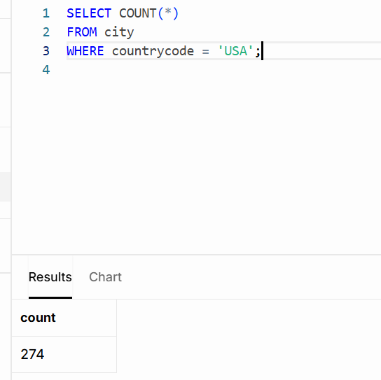
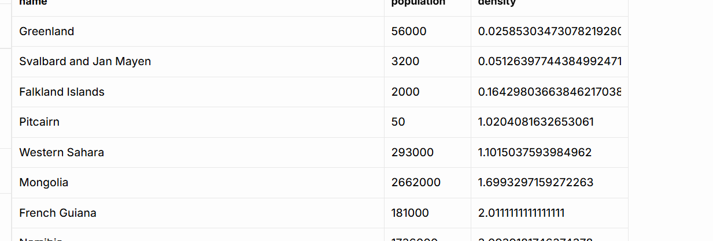

# 🗄️ SQL: Northwind and World analysis

36 SQL queries in PostgreSQL that answer business questions on two sample databases, plus a team database design and plain-English explanations of database types and joins.

## 🔎 At a glance

| | |
|---|---|
| **Tools** | SQL (PostgreSQL) in Supabase |
| **Datasets** | Northwind sample database (customers, orders, order details, products, categories, suppliers, employees); World sample database (city and country tables) |
| **Bootcamp week** | Week 3 (September to October 2026), Level 3 Data Technician Skills Bootcamp, Leep Talent |
| **Type** | Individual queries; the SkillUp Academy database design was a team exercise |
| **Files** | My completed Week 3 workbook, all 36 queries as `.sql` files, and a screenshot of each World result |

## 🎯 Objective

- **Design:** SkillUp Academy, a small training company, keeps all its data in one spreadsheet, which causes duplicates and inconsistent records. Design a relational database to replace it, and advise which new data (website clicks, activity logs, learner feedback, uploaded documents) would suit a non-relational database.
- **Northwind:** as a junior analyst at Northwind Traders, answer 18 requests from colleagues.
- **World:** as a junior analyst at a research organisation, answer 18 questions about countries and cities.

## 🗂️ Data

Northwind is a sample database for a small food trading company. World is a sample database of countries and cities, with population, surface area, continent, life expectancy and capital city. Both are teaching datasets, and the World figures are old, so the results describe the sample, not the world today.

## 🛠️ Approach

1. **Team design (SkillUp Academy).** In a breakout room, our team wrote a purpose statement for the database, chose four tables with a primary key each, and defined two one-to-many relationships.
2. **Database types.** I explained how relational and NoSQL databases store data, and picked user activity logs and learner feedback as the data that suits a non-relational database, because its structure varies.
3. **Joins.** I explained five join types in plain English and chose a join for each of six SkillUp reporting needs.
4. **Northwind, Day 2.** Ten queries filtering and sorting single tables with `WHERE`, `IN`, `BETWEEN`, `DISTINCT` and `ORDER BY`.
5. **Northwind, Day 3.** Eight queries joining two or three tables, including counts and totals with `GROUP BY`.
6. **World.** 18 queries using `LIKE`, `LIMIT`, `OFFSET`, `COUNT`, `AVG`, a calculated column and joins, with a screenshot of each result.

## 🧩 The SkillUp Academy design (team exercise)

| Table | Primary key | Other columns |
|---|---|---|
| Learners | LearnerID | FirstName, LastName, Email, PhoneNumber, DateOfBirth |
| Trainers | TrainerID | FirstName, LastName, Email |
| Courses | CourseID | CourseName, StartDate, DurationWeeks, Price, TrainerID (foreign key) |
| Enrolments | EnrolmentID | LearnerID (foreign key), CourseID (foreign key), EnrolmentDate, Status (Active, Completed or Withdrawn) |

One learner can have many enrolments, but each enrolment belongs to one learner, so staff can see every course a learner is taking without repeating their details. One trainer can teach many courses, and each course is led by one trainer.

## 🔗 Joins matched to reporting needs

| Reporting need | Join I chose | Why |
|---|---|---|
| Only learners who are enrolled on a course | Inner | Returns only learners with a matching enrolment |
| All courses, including those with no enrolments | Left | Keeps every course; learner columns show NULL where nobody has enrolled |
| All learners and all courses, linked or not | Full outer | Keeps learners with no course and courses with no learners |
| Every combination of learners and courses | Cross | Pairs every learner with every course |
| Learners compared with other learners | Inner | Matches learners on the same course or city |
| Enrolments even where related data is missing | Left | Keeps every enrolment and fills gaps with NULL |

## 🧾 Northwind query highlights

**Supply chain overview: three tables in one report (Day 3, Q5)**

```sql
SELECT p.productname, c.categoryname, s.suppliername
FROM products AS p
JOIN categories AS c ON p.categoryid = c.categoryid
JOIN suppliers  AS s ON s.supplierid = p.supplierid;
```

The products table holds a category ID and a supplier ID, so two joins put the product, category and supplier names side by side in one row.

**Number of products in each category (Day 3, Q7)**

```sql
SELECT COUNT(productname) AS numberofproducts, categoryname
FROM products AS p
JOIN categories AS c ON p.categoryid = c.categoryid
GROUP BY categoryname;
```

`GROUP BY` collapses the products into one row per category, and `COUNT` gives the number in each.

**Total quantity ordered for each product (Day 3, Q8)**

```sql
SELECT p.productname, p.price, SUM(od.quantity) AS total_quantity
FROM products AS p
JOIN order_details AS od ON p.productid = od.productid
GROUP BY p.productid, p.productname, p.price;
```

The order details table has one row for each product on each order, so summing the quantity by product gives the total units ordered.

## 🌍 World queries and results

All figures come from the sample database. Three examples:

**How many cities does the USA have? (Q1)** A `COUNT` with a `WHERE` filter on the country code returns 274.



**Capital cities ranked by population (Q16)** The country table stores each capital as a city ID, so the join runs from `country.capital` to `city.id`. Seoul comes first (9,981,619), then Jakarta and Ciudad de México.


**The least densely populated countries (Q17)** Density is a calculated column: population divided by surface area. I excluded countries with a population of 0 so uninhabited territories don't fill the list. Greenland comes first, at about 0.03 people per square kilometre.



Every World query, with its result and screenshot:

| Q | Question | Result | Screenshot |
|---|---|---|---|
| 1 | Cities in the USA | 274 | [View](images/world-results/q01-us-city-count.png) |
| 2 | Highest life expectancy | Andorra, 83.5 | [View](images/world-results/q02-highest-life-expectancy.png) |
| 3 | Cities with "New" in the name | Includes Newcastle and Newport | [View](images/world-results/q03-cities-named-new.png) |
| 4 | 10 most populous cities | Mumbai (Bombay), then Seoul and São Paulo | [View](images/world-results/q04-top-10-cities.png) |
| 5 | Cities over 2,000,000 people | Alger, Luanda, Buenos Aires and others | [View](images/world-results/q05-cities-over-2m.png) |
| 6 | Cities beginning with "Be" | Belém, Berezniki, Belmopan and others | [View](images/world-results/q06-cities-starting-be.png) |
| 7 | Cities with 500,000 to 1,000,000 people | Amsterdam, Rotterdam, Oran and others | [View](images/world-results/q07-cities-500k-to-1m.png) |
| 8 | All cities A to Z | Names starting with a symbol, such as a bracket, sort first | [View](images/world-results/q08-cities-a-to-z.png) |
| 9 | Most populated city | Mumbai (Bombay), 10,500,000 | [View](images/world-results/q09-most-populated-city.png) |
| 10 | How often each city name appears | One row per name with a count | [View](images/world-results/q10-city-name-frequency.png) |
| 11 | Least populated city | Adamstown, 42 | [View](images/world-results/q11-least-populated-city.png) |
| 12 | Most populous country | China, 1,277,558,000 | [View](images/world-results/q12-largest-country.png) |
| 13 | Capital of Spain | Madrid | [View](images/world-results/q13-capital-of-spain.png) |
| 14 | Cities in Europe | 841 cities | [View](images/world-results/q14-cities-in-europe.png) |
| 15 | Average city population by country | Singapore, 4,017,733 (its only listed city is Singapore) | [View](images/world-results/q15-avg-city-population.png) |
| 16 | Capital cities by population | Seoul, then Jakarta and Ciudad de México | [View](images/world-results/q16-capital-cities-by-population.png) |
| 17 | Least densely populated countries | Greenland, then Svalbard and Jan Mayen, and the Falkland Islands | [View](images/world-results/q17-lowest-density.png) |
| 18 | Cities ranked 31st to 40th | Starts with Shenyang, Kanton (Guangzhou) and Singapore | [View](images/world-results/q18-cities-ranked-31-to-40.png) |

## 💡 Skills used

**Technical**
- Filtering with `WHERE`, `IN`, `BETWEEN`, `LIKE` and `IS NOT NULL`
- Inner joins across up to three tables, including a join on a less obvious key (a country to its capital city)
- Aggregates with `COUNT`, `SUM` and `AVG`, grouped with `GROUP BY`
- Sorting and paging with `ORDER BY`, `LIMIT` and `OFFSET`
- Relational design: primary keys, foreign keys and one-to-many relationships

**Transferable**
- Turning a plain-English request into a query
- Explaining technical choices in plain English for a non-technical reader
- Agreeing a design as a team

## 🧠 Challenges and what I'd change

Looking back, a few queries don't fully answer the request as written. The `.sql` files and my workbook show them as I submitted them.

- **Read the whole request.** Day 3 Q6 asks for the 1996 orders "and their customers", but my query returns the orders table on its own, which shows customer IDs rather than names. A join to customers would complete it. Similarly, Q4 asks for one employee name, and mine returns the first name, last name and employee ID as separate columns.
- **Inner joins can drop rows.** Q7 and Q8 ask for "all categories" and "all products". An inner join leaves out any category with no products, or any product that has never been ordered. Starting from that table with a `LEFT JOIN` keeps them.
- **One answer, not a list.** World Q2 asks for one country. My query lists every country from highest to lowest, so the answer is the top row. `ORDER BY` with `LIMIT 1` would return Andorra alone, and the `GROUP BY` isn't needed because there's no aggregate.
- **`LIKE` matches part-words.** `'%New%'` finds Newcastle and Newport as well as cities that start with the word "New".
- **Readable output.** The averages in Q15 and the densities in Q17 show long strings of decimal places. `ROUND` would make them easier to read.

## 💼 Where this applies

Audit and tax work often involves pulling samples and totals from a client's systems. Knowing that an inner join can drop records without warning is a completeness check: is anything missing from the data I'm testing? For analysts, SQL is the everyday route from a business question to an answer.

## 📁 Repository contents

| File or folder | What it is |
|---|---|
| `Data_Technician_Workbook_Week_3.docx` | My completed Week 3 workbook: the team design, written answers on databases and joins, every query, and the World screenshots |
| `queries/northwind_business_queries.sql` | The 18 Northwind queries |
| `queries/world_practical.sql` | The 18 World queries, with key results noted |
| `images/world-results/` | A screenshot of each World query result |
