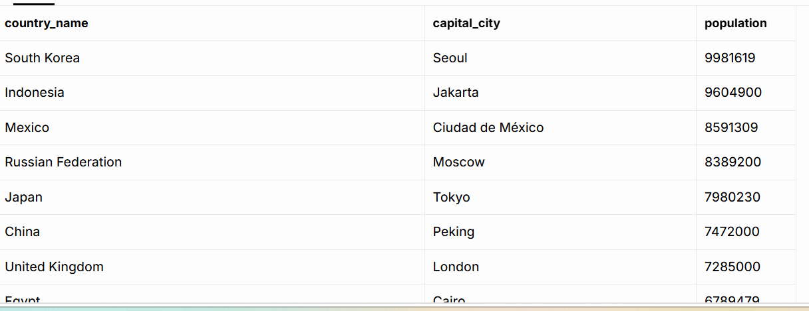

# 🗄️ SQL: Northwind and World analysis

**36 PostgreSQL queries answering business questions on two sample databases, plus a team database design.**

From Week 3 of my bootcamp. As a junior analyst, I answered 18 requests from colleagues at Northwind Traders and 18 questions about countries and cities in the World database, running every query in my own Supabase project. I also explained database types and joins in plain English, and helped design a database for a training company as a team exercise.

## 🔎 At a glance

| | |
|---|---|
| **Tools** | SQL (PostgreSQL) in Supabase |
| **Datasets** | Northwind sample database (customers, orders, order details, products, categories, suppliers, employees); World sample database (city and country tables) |
| **Bootcamp week** | Week 3 (September to October 2026), Level 3 Data Technician Skills Bootcamp, Leep Talent |
| **Type** | Individual queries; the SkillUp Academy database design was a team exercise |
| **Files** | My completed Week 3 workbook, all 36 queries as `.sql` files, and a screenshot of each World result |

## 💡 Skills demonstrated

**✔️ Querying and filtering**
- `SELECT`, `SELECT DISTINCT` and column aliases (`AS`)
- Filtering with `WHERE`, `AND`, `OR`, `IN`, `BETWEEN`, `LIKE` and `IS NOT NULL` (Northwind Day 2, World)
- Sorting and paging with `ORDER BY`, `LIMIT` and `OFFSET` (Northwind Day 2, World)

**✔️ Joining and summarising**
- Inner joins across up to three tables (Northwind Day 3), including a join on a less obvious key: a country to its capital city (World Q16)
- `COUNT`, `SUM` and `AVG`, grouped with `GROUP BY` (Northwind Day 3, World)
- A calculated column: population divided by surface area (World Q17)

**✔️ Database design**
- Primary keys, foreign keys and one-to-many relationships (SkillUp Academy, team exercise)
- When to use a relational or a NoSQL database
- Five join types explained in plain English and matched to six reporting needs

**✔️ Working with business requests**
- Turning a colleague's plain-English request into a query
- Explaining technical choices for a non-technical reader

## 📗 Exercises covered

| Task | What I did |
|---|---|
| Team design | SkillUp Academy, a small training company, kept all its data in one spreadsheet. Our team chose four tables with a primary key each and two one-to-many relationships to replace it. |
| Database types | Explained how relational and NoSQL databases store data, and picked activity logs and learner feedback as data that suits a non-relational database, because its structure varies |
| Joins | Chose a join type for each of six SkillUp reporting needs |
| Northwind, Day 2 | Ten queries filtering and sorting single tables |
| Northwind, Day 3 | Eight queries joining two or three tables, including counts and totals |
| World | 18 queries, with a screenshot of each result |

Both databases are teaching datasets, created in Supabase with Leep Talent's setup scripts. The World figures are old, so the results describe the sample, not the world today.

### The SkillUp Academy design (team exercise)

| Table | Primary key | Other columns |
|---|---|---|
| Learners | LearnerID | FirstName, LastName, Email, PhoneNumber, DateOfBirth |
| Trainers | TrainerID | FirstName, LastName, Email |
| Courses | CourseID | CourseName, StartDate, DurationWeeks, Price, TrainerID (foreign key) |
| Enrolments | EnrolmentID | LearnerID (foreign key), CourseID (foreign key), EnrolmentDate, Status |

One learner can have many enrolments, so staff can see every course a learner takes without repeating their details.

### Joins matched to reporting needs

| Reporting need | Join I chose |
|---|---|
| Only learners who are enrolled on a course | Inner |
| All courses, including those with no enrolments | Left |
| All learners and all courses, linked or not | Full outer |
| Every combination of learners and courses | Cross |
| Learners compared with other learners | Inner |
| Enrolments even where related data is missing | Left |

## 🧾 Northwind query highlights

**Supply chain overview: three tables in one report (Day 3, Q5)**

```sql
SELECT p.productname, c.categoryname, s.suppliername
FROM products AS p
JOIN categories AS c ON p.categoryid = c.categoryid
JOIN suppliers  AS s ON s.supplierid = p.supplierid;
```

Two joins put the product, category and supplier names side by side in one row.

**Total quantity ordered for each product (Day 3, Q8)**

```sql
SELECT p.productname, p.price, SUM(od.quantity) AS total_quantity
FROM products AS p
JOIN order_details AS od ON p.productid = od.productid
GROUP BY p.productid, p.productname, p.price;
```

The order details table has one row for each product on each order, so summing the quantity by product gives the total units ordered.

## 📈 World results

**Capital cities ranked by population (Q16).** The country table stores each capital as a city ID, so the join runs from `country.capital` to `city.id`. Seoul comes first (9,981,619), then Jakarta and Ciudad de México.



| Q | Question | Result | Screenshot |
|---|---|---|---|
| 1 | Cities in the USA | 274 | [View](images/world-results/q01-us-city-count.png) |
| 2 | Highest life expectancy | Andorra, 83.5 | [View](images/world-results/q02-highest-life-expectancy.png) |
| 3 | Cities with "New" in the name | Includes Newcastle and Newport | [View](images/world-results/q03-cities-named-new.png) |
| 4 | 10 most populous cities | Mumbai (Bombay), then Seoul and São Paulo | [View](images/world-results/q04-top-10-cities.png) |
| 5 | Cities over 2,000,000 people | Alger, Luanda, Buenos Aires and others | [View](images/world-results/q05-cities-over-2m.png) |
| 6 | Cities beginning with "Be" | Belém, Berezniki, Belmopan and others | [View](images/world-results/q06-cities-starting-be.png) |
| 7 | Cities with 500,000 to 1,000,000 people | Amsterdam, Rotterdam, Oran and others | [View](images/world-results/q07-cities-500k-to-1m.png) |
| 8 | All cities A to Z | Names starting with a symbol, such as a bracket, sort first | [View](images/world-results/q08-cities-a-to-z.png) |
| 9 | Most populated city | Mumbai (Bombay), 10,500,000 | [View](images/world-results/q09-most-populated-city.png) |
| 10 | How often each city name appears | One row per name with a count | [View](images/world-results/q10-city-name-frequency.png) |
| 11 | Least populated city | Adamstown, 42 | [View](images/world-results/q11-least-populated-city.png) |
| 12 | Most populous country | China, 1,277,558,000 | [View](images/world-results/q12-largest-country.png) |
| 13 | Capital of Spain | Madrid | [View](images/world-results/q13-capital-of-spain.png) |
| 14 | Cities in Europe | 841 cities | [View](images/world-results/q14-cities-in-europe.png) |
| 15 | Average city population by country | Singapore, 4,017,733 (its only listed city is Singapore) | [View](images/world-results/q15-avg-city-population.png) |
| 16 | Capital cities by population | Seoul, then Jakarta and Ciudad de México | [View](images/world-results/q16-capital-cities-by-population.png) |
| 17 | Least densely populated countries | Greenland (about 0.03 people per square kilometre), then Svalbard and Jan Mayen | [View](images/world-results/q17-lowest-density.png) |
| 18 | Cities ranked 31st to 40th | Starts with Shenyang, Kanton (Guangzhou) and Singapore | [View](images/world-results/q18-cities-ranked-31-to-40.png) |

## 🎓 Key learning outcomes

- **Find the key that links two tables.** A country's capital is stored as a city ID, so the join has to run from `country.capital` to `city.id`.
- **Filter out rows that distort a ranking.** I excluded countries with a population of 0 so uninhabited territories didn't fill the density list.
- **Good design removes repetition.** Splitting learners and enrolments into separate tables means each learner's details are stored once.

## 🧠 What I'd change

My workbook and `.sql` files show the queries as I submitted them.

- **Read the whole request.** Day 3 Q6 asks for the 1996 orders "and their customers", but my query shows customer IDs rather than names. A join to customers would complete it.
- **Inner joins can drop rows.** Q7 and Q8 ask for "all categories" and "all products". An inner join leaves out any category with no products, or any product never ordered. A `LEFT JOIN` keeps them.
- **One answer, not a list.** World Q2 asks for one country. `ORDER BY` with `LIMIT 1` would return Andorra alone.
- **`LIKE` matches part-words.** `'%New%'` finds Newcastle and Newport as well as cities that start with the word "New".
- **Round long decimals.** `ROUND` would make the averages in Q15 and the densities in Q17 easier to read.

## 🛠️ Tools and technologies

- **PostgreSQL:** every query
- **Supabase:** hosting both databases and running queries in the SQL Editor

## 📁 Repository contents

| File or folder | What it is |
|---|---|
| `Data_Technician_Workbook_Week_3.docx` | My completed Week 3 workbook: the team design, written answers on databases and joins, every query, and the World screenshots |
| `queries/northwind_business_queries.sql` | The 18 Northwind queries |
| `queries/world_practical.sql` | The 18 World queries, with key results noted |
| `images/world-results/` | A screenshot of each World query result |
| `Create Northwind Tables on Supabase.docx` | Leep Talent's setup script that creates and fills the Northwind tables in Supabase |
| `Create World DB on Supabase.txt` | Leep Talent's setup script that creates and fills the World tables in Supabase |
| `Day 2 Supabase SQL Queries.txt` | SQL queries from the Day 2 class, supplied by Leep Talent |
| `world database tasks solutions.docx` | Leep Talent's model answers for the World tasks, to compare with mine |

The last four files are course materials from Leep Talent, not my own work.
